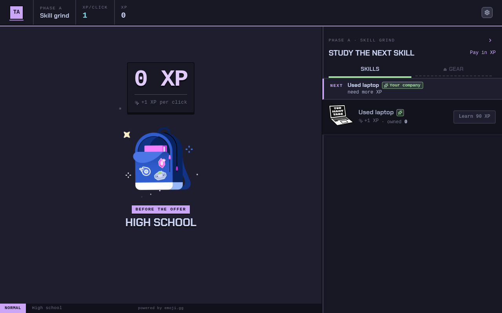

# tech-ascension

An idle clicker about a programmer's career.

[](https://github.com/RafaelBroseghini/tech-ascension/actions/workflows/ci.yml)
[](https://github.com/RafaelBroseghini/tech-ascension/actions/workflows/pages.yml)


## Run

```bash
npm i && npm run dev
```

Open [http://127.0.0.1:43123](http://127.0.0.1:43123).

```bash
npm test             # unit tests
npm run smoke:play   # plays the game through window.__GAME__
npm run build
```


